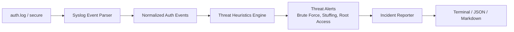

# AuthLog Lens

Defensive Linux authentication log analyzer and intrusion detection CLI for security auditing.

[](https://github.com/AliSaleh07/authlog-lens/actions/workflows/ci.yml)

## Core Capabilities

- **Syslog Parsing**: Ingests standard Linux `auth.log`, `secure`, and ISO-8601 syslog streams.
- **Intrusion Heuristics**: Detects repeated SSH brute-force spikes, credential stuffing across accounts, and direct root login targeting.
- **Compromise Indicators**: Identifies high-risk patterns such as successful logins immediately preceded by multiple failures from the same source IP.
- **Structured Reporting**: Exports findings to interactive terminal tables, JSON reports for SIEM ingestion, or Markdown summaries.



## Detection Heuristics

| Alert | Severity | Trigger Criteria |
|---|---|---|
| `BRUTE_FORCE_SSH` | CRITICAL / HIGH | $\ge 5$ failed login attempts from a single source IP |
| `CREDENTIAL_STUFFING` | HIGH | $\ge 4$ distinct usernames targeted by a single source IP |
| `SUCCESS_AFTER_FAILURE` | CRITICAL | Successful authentication following multiple failed attempts |
| `ROOT_LOGIN_TARGETING` | HIGH | Direct authentication attempts against the `root` superuser |
| `INVALID_USER` | MEDIUM | Authentication attempts targeting non-existent system users |

## Quickstart

```bash
python -m venv .venv
source .venv/bin/activate
pip install -r requirements.txt
pip install -e .
```

## Usage

```bash
# Analyze an auth log file
authlog-lens analyze /var/log/auth.log

# Strict mode (exit code 1 on Critical/High threats)
authlog-lens analyze /var/log/auth.log --strict

# Export JSON incident report
authlog-lens analyze /var/log/auth.log --format json -o incident.json
```

## Running Tests

```bash
pytest -v tests/
```
